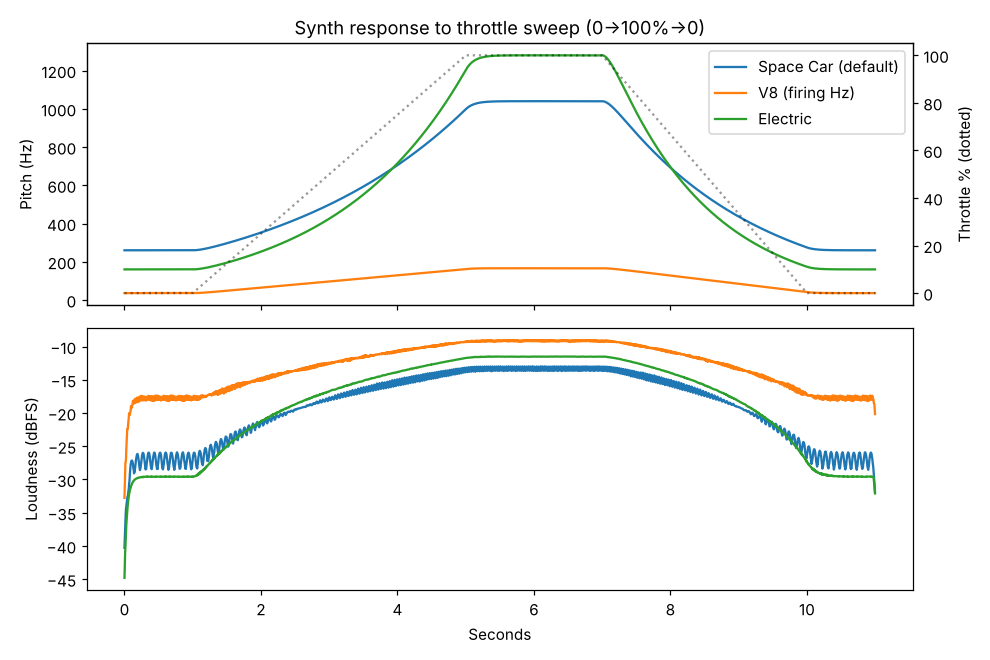

# Engine Sounds (iOS)

Move your phone, hear an engine. Speed (estimated from the accelerometer) drives the **pitch and volume** of a real-time synthesized engine. Default sound is a futuristic warbling "space car"; V8 and Electric are also included.

## Build

Requires a Mac with Xcode 15+ and [XcodeGen](https://github.com/yonaskolb/XcodeGen).

```bash
brew install xcodegen
xcodegen generate
open EngineSounds.xcodeproj
```

Set your signing team, then run on a real iPhone (the Simulator has no accelerometer — use **Hold to Rev** there).

## How it works

| File | Role |
|---|---|
| `MotionSpeedEstimator.swift` | CoreMotion `userAcceleration` (gravity removed) → rotated to world frame → leaky-integrated into a velocity vector (τ = 2 s) → speed in m/s |
| `EngineController.swift` | Maps speed to throttle `min(speed / topSpeed, 1)`; Sensitivity slider sets `topSpeed` (0.5–5 m/s) |
| `EngineSynth.swift` | `AVAudioSourceNode` procedural synth; throttle glides over ~120 ms to avoid clicks |
| `ContentView.swift` | Gauge, sound picker, sensitivity/volume, Start/Stop, Hold to Rev |

### Sound profiles (throttle 0 → 100%)

| Profile | Pitch | Character |
|---|---|---|
| Space Car (default) | 260 → 1040 Hz (2 octaves) | Theremin-like tone, vibrato 5.5→9.5 Hz, "bubble" pulse 12→34 Hz, detuned fifth shimmer |
| V8 | 36 → 166 firings/s | Deep rumble: firing-rate bass + 2nd harmonic, slow-decay pulses, 4-firing lope, 2-pole low-pass (300 → 1600 Hz), saturation so bass survives phone speakers |
| Electric | 160 → 1280 Hz (3 octaves) | Clean sine whine + inverter partial |

Loudness rises ~15 dB from idle to full throttle. Listen to `docs/previews/*.wav` (rendered by `tools/render_preview.py`, a Python port of the DSP):



### Limitation

An accelerometer measures *acceleration*, not velocity. The estimate rises when you speed up and decays back to idle ~2 s after you stop accelerating — so at a steady cruise in a car it will idle. For true road speed, add a GPS mode (`CLLocation.speed`).
